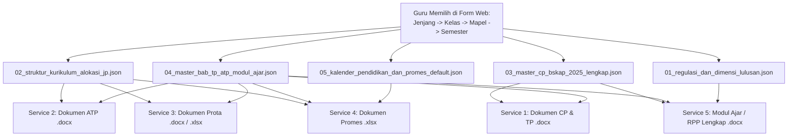

# Master Dataset Kurikulum Nasional — GuruDok

Folder ini berisi **Master Dataset Kurikulum Nasional (SD, SMP, SMA)** yang diekstraksi langsung dari dokumen regulasi resmi **Kementerian Pendidikan Dasar dan Menengah (Kemendikdasmen)** terbaru. Dataset ini menjadi fondasi utama bagi sistem **GuruDok** (Deterministic Document Generator Tanpa AI) untuk mengotomatisasi pengisian dokumen administrasi guru.

---

## 1. Sumber Regulasi Resmi Pemerintah (100% Valid & Terbuka)

Seluruh data di dalam folder ini disusun berdasarkan dokumen hukum yang diunduh langsung dari portal resmi [kurikulum.kemendikdasmen.go.id](https://kurikulum.kemendikdasmen.go.id):

1. **Keputusan Kepala BSKAP Kemendikdasmen Nomor 046/H/KR/2025** *(Ditetapkan 16 Juli 2025)* tentang Capaian Pembelajaran pada PAUD, Jenjang Pendidikan Dasar, dan Jenjang Pendidikan Menengah *(mencabut dan menggantikan Kepka BSKAP No. 032/H/KR/2024)*.
2. **Permendikdasmen Nomor 13 Tahun 2025** tentang Perubahan Atas Permendikbudristek Nomor 12 Tahun 2024 tentang Kurikulum pada PAUD, Jenjang Pendidikan Dasar, dan Jenjang Pendidikan Menengah *(memuat tabel resmi Struktur Kurikulum & Alokasi Waktu JP per tahun/minggu)*.
3. **Permendikdasmen Nomor 10 Tahun 2025** tentang Standar Kompetensi Lulusan *(menetapkan **8 Dimensi Profil Lulusan** sebagai penyempurnaan Profil Pelajar Pancasila)*.
4. **Panduan Pembelajaran dan Asesmen (PPA) Edisi Revisi Tahun 2025** *(memuat kerangka **Pembelajaran Mendalam / Deep Learning**: Identifikasi, Desain Pembelajaran, Pengalaman Belajar 3M [Memahami, Mengaplikasi, Merefleksi], dan Asesmen)*.

---

## 2. Daftar File Dataset di Folder Ini

| No | Nama File | Isi & Cakupan Data | Dipakai oleh Service GuruDok |
|---|---|---|---|
| **1** | [`01_regulasi_dan_dimensi_lulusan.json`](./01_regulasi_dan_dimensi_lulusan.json) | • Pembagian Fase A s.d. F & durasi menit per JP • **8 Dimensi Profil Lulusan (DPL-1 s.d. DPL-8)** + padanan P5 lama • Kerangka **Pembelajaran Mendalam** (Berkesadaran, Bermakna, Menggembirakan & 3M) • 5 Model Pedagogis (PBL, PjBL, Discovery, Inquiry, Contextual) • Interval KKTP & template kalimat Deskripsi e-Rapor | • **Modul Ajar / RPP** (Service 08) • **ATP** (Service 04) • **Deskripsi Rapor** (Service 16) |
| **2** | [`02_struktur_kurikulum_alokasi_jp.json`](./02_struktur_kurikulum_alokasi_jp.json) | • Alokasi JP Intrakurikuler per tahun, JP Kokurikuler, Total JP, dan JP per minggu resmi untuk **SD (Kelas 1–6), SMP (Kelas 7–9), dan SMA (Kelas 10–12)** • Standar minggu efektif (36 minggu untuk kelas reguler, 32 minggu untuk kelas akhir VI, IX, XII) | • **Prota** (Service 05) • **Promes** (Service 06) • **ATP** (Service 04) |
| **3** | [`03_master_cp_bskap_2025_lengkap.json`](./03_master_cp_bskap_2025_lengkap.json) | • Ekstraksi penuh **46 Mata Pelajaran Resmi (Lampiran II Kepka BSKAP 046/H/KR/2025)** • Mencakup Rasional, Tujuan, Karakteristik, dan **Teks Resmi Capaian Pembelajaran (CP) per Fase (Fase A–F) dan per Elemen** | • **CP dan TP** (Service 03) • **ATP** (Service 04) • **Silabus** (Service 07) • **Modul Ajar / RPP** (Service 08) |
| **4** | [`04_master_bab_tp_atp_modul_ajar.json`](./04_master_bab_tp_atp_modul_ajar.json) | • Pemetaan Bab Semester 1 & 2, rincian Tujuan Pembelajaran (TP), urutan ATP, alokasi JP per bab, Pertanyaan Pemantik, Pemahaman Bermakna, Langkah Kegiatan (Memahami, Mengaplikasi, Merefleksi), LKPD, dan Glosarium lintas jenjang SD, SMP, SMA | • **Modul Ajar / RPP** (Service 08) • **CP dan TP** (Service 03) • **ATP** (Service 04) • **Prota & Promes** (Service 05 & 06) • **LKPD** (Service 09) |
| **5** | [`05_kalender_pendidikan_dan_promes_default.json`](./05_kalender_pendidikan_dan_promes_default.json) | • Matriks distribusi 26 minggu per semester (Juli–Desember & Januari–Juni) • Penanda otomatis minggu efektif (18 minggu), MPLS, STS, SAS, Pengolahan Rapor, dan Libur Semester/Hari Raya | • **Promes** (Service 06) • **Prota** (Service 05) • **Jurnal Mengajar** (Service 14) |
| **6** | [`06_schema_postgresql_gurudok.sql`](./06_schema_postgresql_gurudok.sql) | • Skema DDL SQL PostgreSQL siap pakai (`CREATE TABLE`, `INDEX`, `JSONB`) untuk menampung seluruh dataset di atas di server Contabo VPS | • Backend **FastAPI + PostgreSQL** |

---

## 3. Cara Kerja Relasi Data untuk 5 Service MVP (Tanpa AI)

### Contoh Otomasi Saat Guru Memilih: **SMP -> Kelas 7 -> IPA -> Semester 1**
1. **Dari `02_struktur_kurikulum_alokasi_jp.json`:**
   Sistem langsung tahu bahwa IPA Kelas 7 berada di **Fase D**, durasi **1 JP = 40 menit**, alokasi **4 JP/minggu**, **144 JP/tahun** (72 JP di Semester 1 selama 18 minggu efektif).
2. **Dari `03_master_cp_bskap_2025_lengkap.json`:**
   Sistem mengambil teks resmi CP `MAPEL-15` (IPA Fase D) untuk elemen *Pemahaman IPA* dan *Keterampilan Proses*.
3. **Dari `04_master_bab_tp_atp_modul_ajar.json`:**
   Sistem menarik 3 Bab Semester 1 (*Bab 1: Hakikat Sains & Pengukuran [24 JP]*, *Bab 2: Zat dan Perubahannya [24 JP]*, *Bab 3: Suhu, Kalor, dan Pemuaian [24 JP]*) lengkap dengan kode TP (`TP.7.1.1` dst.), Pertanyaan Pemantik, Skenario Kegiatan *Memahami-Mengaplikasi-Merefleksi*, dan LKPD.
4. **Dari `05_kalender_pendidikan_dan_promes_default.json`:**
   Sistem memetakan Bab 1 ke Minggu Efektif 1–6 (Juli–Agustus), Bab 2 ke Minggu Efektif 7–12 (September–Oktober, melompati minggu STS), dan Bab 3 ke Minggu Efektif 13–18 (Oktober–November).
5. **Injeksi ke Template (`docxtpl` & `openpyxl`):**
   Seluruh data di atas digabungkan dengan **Data Profil Guru & Sekolah** (`nama_guru`, `nip`, `nama_sekolah`, `nama_kepsek`) dan menghasilkan file `.docx` dan `.xlsx` siap cetak dalam waktu **< 1 detik**.
